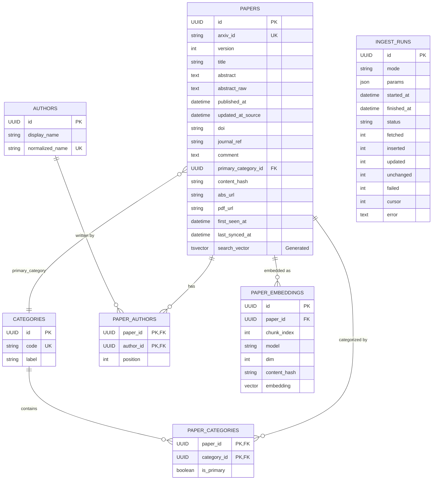

# Database Schema

## Entity Relationship Diagram

## Index Rationale

| Table | Index / Constraint | Purpose / Query Supported |
|---|---|---|
| `papers` | `UNIQUE(arxiv_id)` | Upsert idempotency during ingestion (`INSERT ... ON CONFLICT (arxiv_id) DO UPDATE`). Versionless to support arXiv version updates gracefully. |
| `papers` | `INDEX(published_at)` | Aggregations: `GET /api/v1/stats/papers-over-time`. Fast date filtering. |
| `papers` | `INDEX(updated_at_source)` | Identifying out-of-date papers during incremental ingestions. |
| `papers` | `INDEX(primary_category_id)` | Fast top-level category groupings and aggregations. |
| `papers` | `GIN(search_vector)` | Full-text hybrid search (FTS leg of Reciprocal Rank Fusion). Generated column from `title` and `abstract`. |
| `authors` | `UNIQUE(normalized_name)` | Global author deduplication across papers. |
| `categories` | `UNIQUE(code)` | Guarantee idempotency when lazily seeding categories from the arXiv XML. |
| `paper_embeddings` | `HNSW(embedding)` | Fast Approximate Nearest Neighbor (ANN) vector search (Vector leg of RRF). Uses `vector_cosine_ops`. Configured with `m=16`, `ef_construction=64`. |
| `paper_embeddings` | `UNIQUE(paper_id, chunk_index, model)` | Prevents duplicating chunks for the same embedding model per paper. |
| `paper_categories` | `INDEX(category_id, paper_id)` | Fast lookup of all papers for a specific category. |
| `paper_authors` | `INDEX(author_id)` | Fast lookup of all papers for a specific author. |

## Important Design Constraints
1. **Cascade Deletes**: `paper_embeddings`, `paper_authors`, and `paper_categories` all have `ON DELETE CASCADE` foreign keys pointing to `papers`. A `wipe` operation can simply `TRUNCATE papers CASCADE` and efficiently clean up related states.
2. **Selective Re-Embedding**: `papers.content_hash` vs `paper_embeddings.content_hash`. The indexer compares these hashes. If a paper's text changes mid-crawl, the row is updated, and the new hash triggers the selective re-embedder instead of a full recompute.
3. **Generated TSVECTOR**: The `search_vector` on `papers` is maintained directly by Postgres triggers (`GENERATED ALWAYS AS`). No application-level sync logic is required, meaning keyword search is perfectly consistent.
